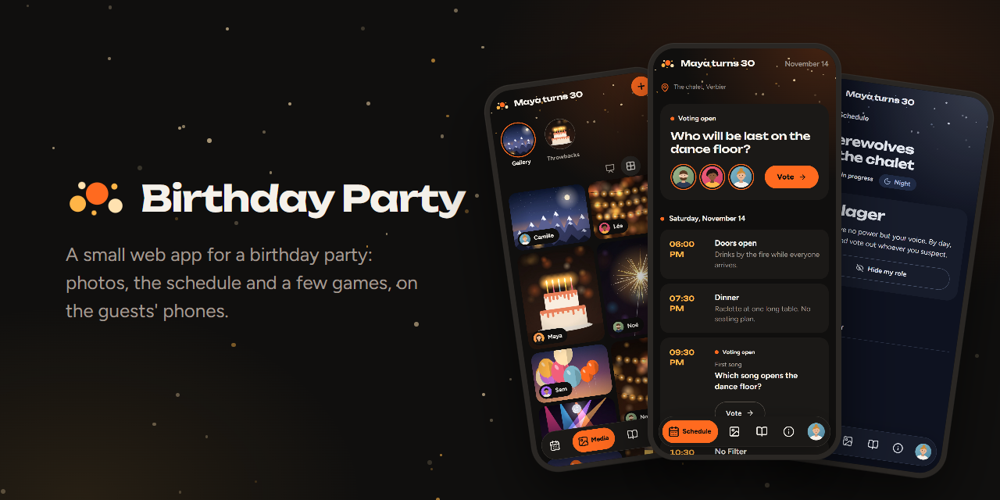
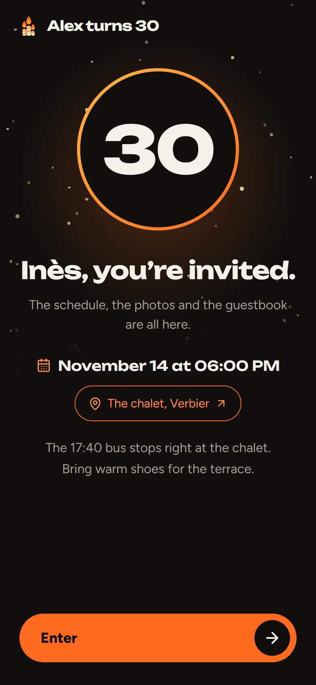
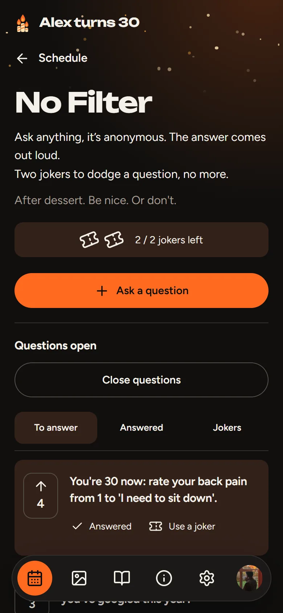
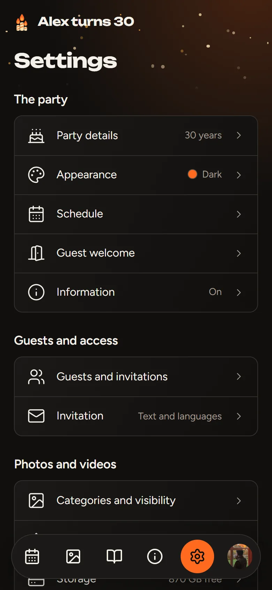

<p align="center">
  
</p>

# Birthday Party

One link per guest, and the whole party lives on their phone: everyone's photos
and videos, the evening's schedule, live votes, a werewolf game and the
guestbook. No account, no app to install, and it runs on your own server.

<p align="center">
  
  
  
</p>

## What guests get

- **Everyone's photos and videos** in one gallery, full quality, with a slideshow for the TV.
- **The schedule**, with surprises that stay hidden until their time and a notification when they're revealed.
- **Live votes** and **No Filter**, a game of anonymous questions the host answers out loud.
- **Werewolf**: each player gets their secret role on their phone, the game master runs the board.
- **A guestbook**, signed or anonymous, and a page of practical info: how to get there, where to sleep.

<p align="center">
  
  
  
</p>

## What the host gets

Everything is managed from the same phone: guests and their links, the
schedule, a step-by-step welcome before the party opens, who sees which album,
and the look of the app, dark or light, in any colour.

<p align="center">
  
  
  
</p>

It works in French, English, German, Italian and Spanish, following each
guest's phone.

<sub>The screenshots show a made-up party; its photos and portraits are drawings made for the demo.</sub>

## Private by default

Only people with a link from the host get in. Photos, videos, messages and
votes stay on your server, and anonymous means anonymous for the host too.

## Try it in a minute

```sh
git clone https://github.com/AlexPresso/birthday-party.git
cd birthday-party
docker compose up -d
docker compose logs backend
```

Open the `Administrator invitation:` link from the logs and you're the host of
an empty party at http://localhost:3000. To put it online or work on the code,
see the [development and deployment guide](docs/development.md).

## License

[AGPL-3.0-only](LICENSE). Bundled fonts and icons keep their own licences,
listed in the [development guide](docs/development.md#third-party-material).
