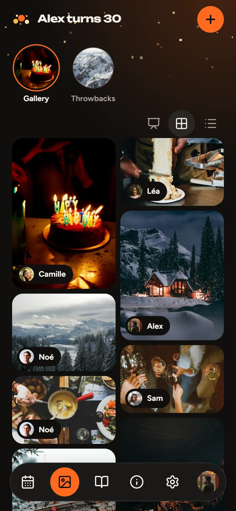
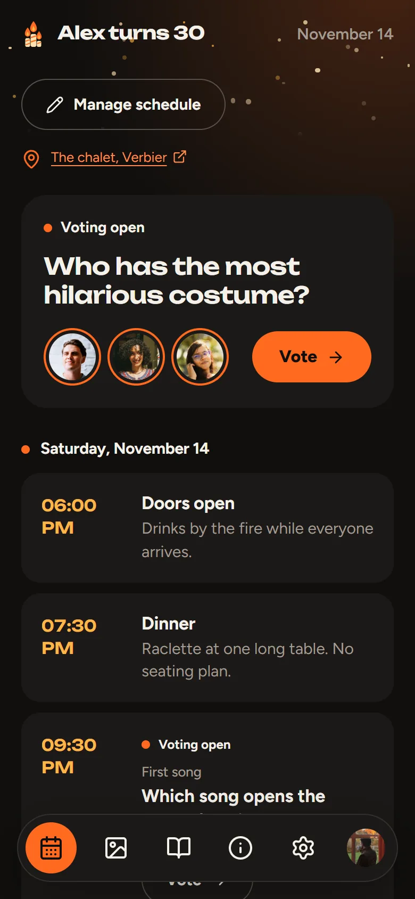
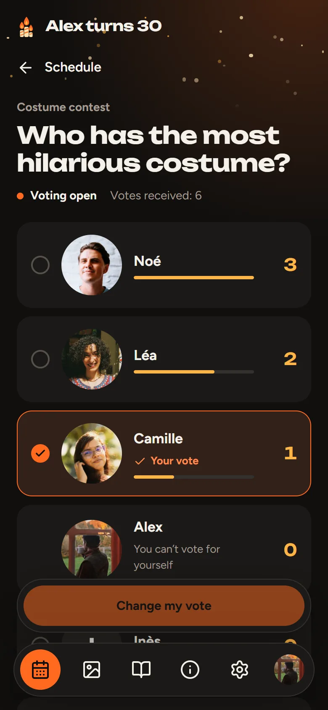
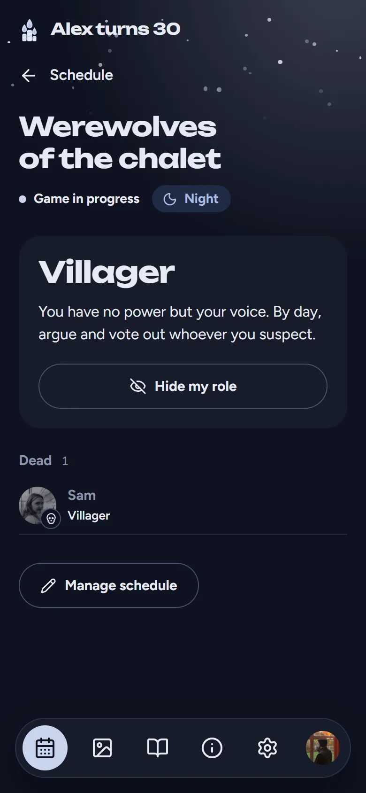
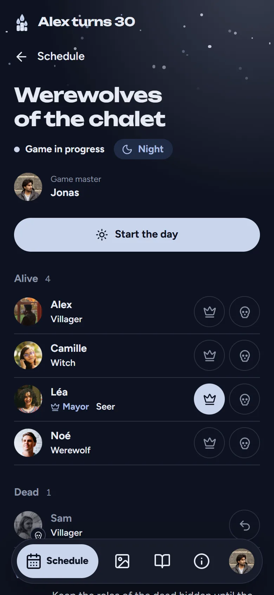
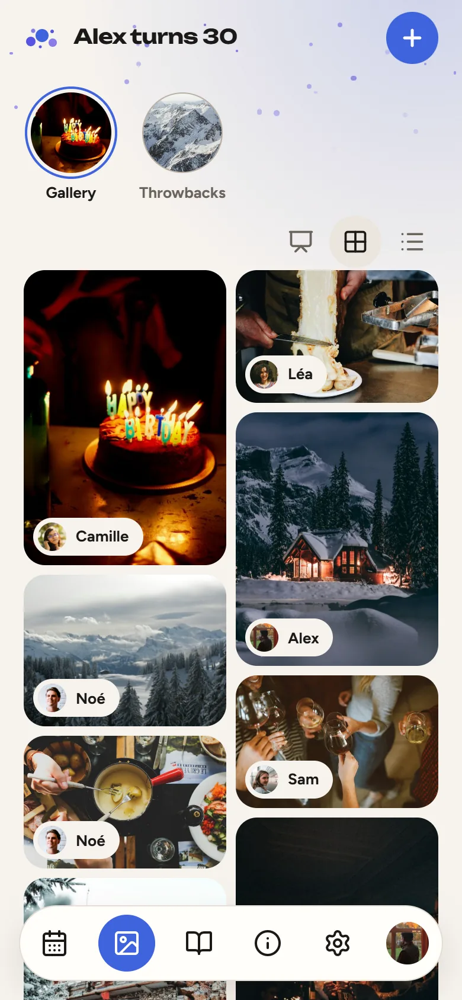

# Birthday Party

A small app made for my 30th birthday, feel free to host and use it too, it was
designed to be modular, reusable and highly customizable!

<p align="center">
  
  
  
</p>

## What's in it

- A shared gallery for everyone's photos and videos, with a slideshow.
- The schedule of the evening, with surprises that appear at their time.
- Votes, an anonymous question game, and a werewolf game where each player
  finds their role on their phone.
- A guestbook and a page for practical details.
- Settings for the host: guests and their links, the schedule, a welcome before
  the party opens, and the look of the app.

<p align="center">
  
  
  
</p>

<p align="center">
  
  
  
</p>

There are no accounts: the host adds guests and sends each one their link. The
app follows the phone's language (French, English, German, Italian or Spanish),
and the photos and messages stay on the server it runs on.

<sub>The screenshots show a made-up party; its photos and portraits come from <a href="https://unsplash.com">Unsplash</a>.</sub>

## Trying it

With Docker:

```sh
git clone https://github.com/AlexPresso/birthday-party.git
cd birthday-party
docker compose up -d
docker compose logs backend
```

The logs show an `Administrator invitation:` link; open it to become the host
of an empty party at http://localhost:3000. Putting it online and working on
the code are covered in the [development guide](docs/development.md).

## Licence

[AGPL-3.0-only](LICENSE). The bundled fonts and icons keep their own licences,
listed in the [development guide](docs/development.md#third-party-material).
