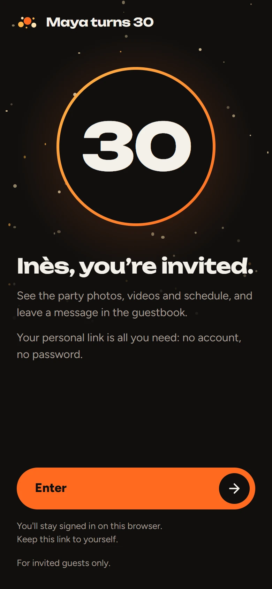
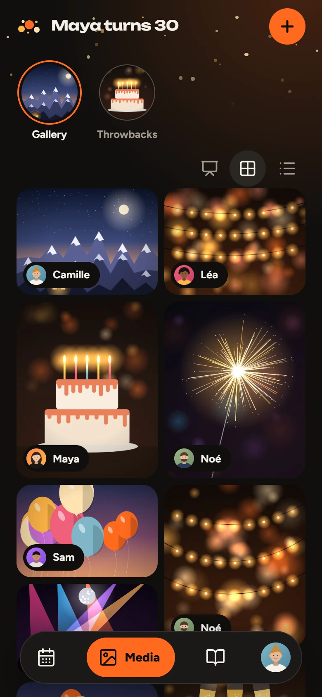
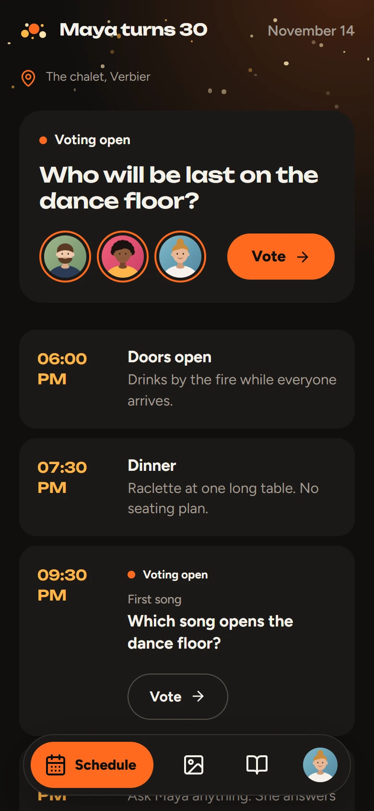
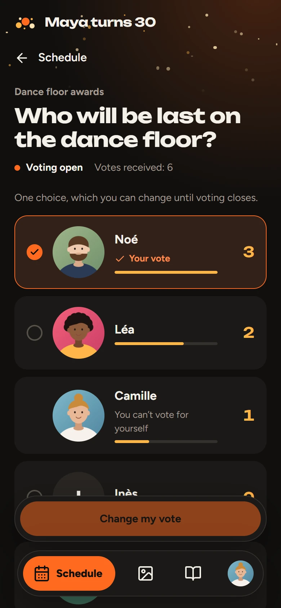
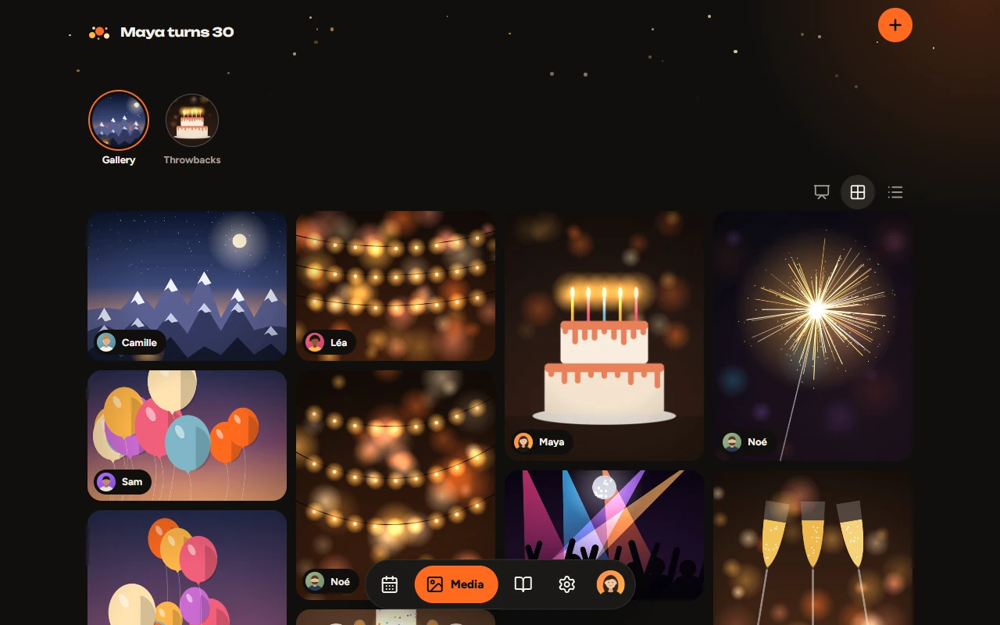
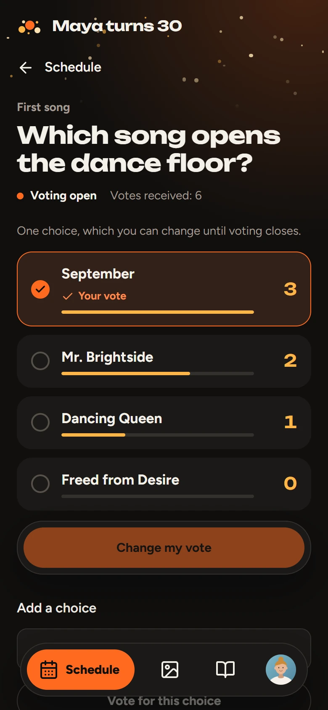
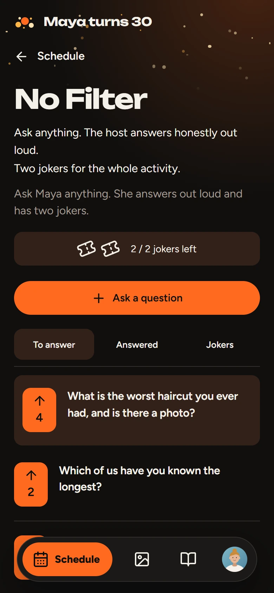
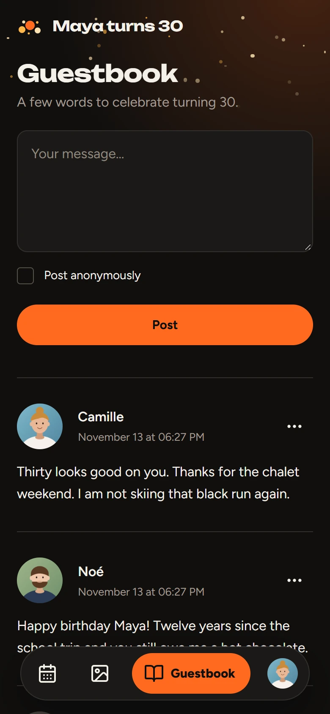
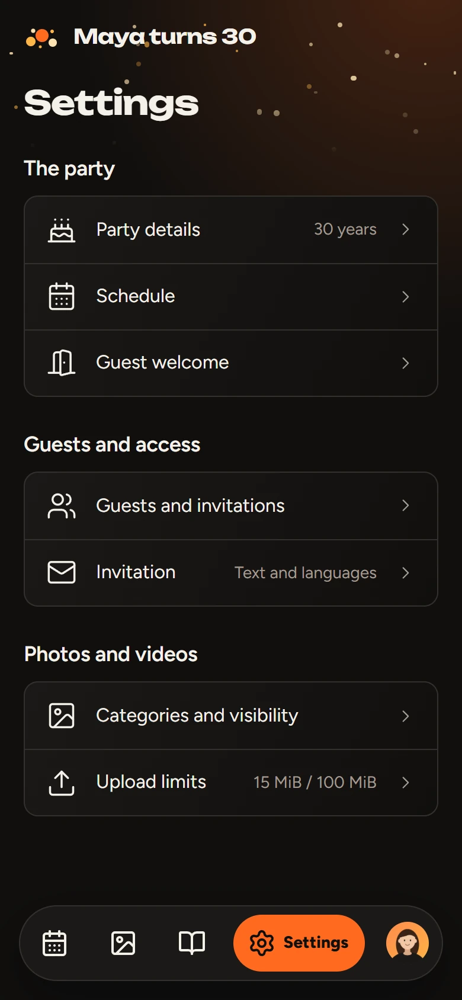
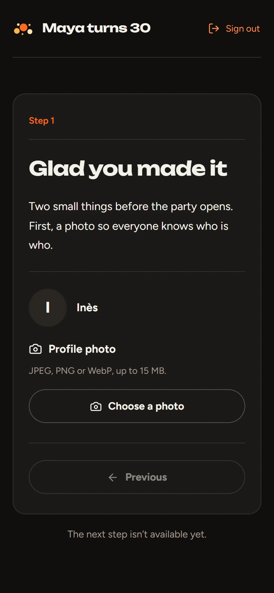

# Birthday Party

A private web app for one birthday party. Guests open a personal link on their
phone, add their photos and videos to a shared gallery, follow the evening's
schedule, vote, ask the host awkward questions and sign the guestbook. The host
runs all of it from a settings screen on the same phone.

It was built for a 30th birthday and is meant to be reused, with one installation
per party. You host it yourself: the records live in PostgreSQL and the media in
a folder on your server.

<p align="center">
  
  
  
  
</p>

<sub>The screenshots show a made-up party. Its photos and portraits are drawings
generated for the demo.</sub>

## What guests see

### A link instead of an account

The host prepares a profile for each guest and sends them a personal link, by
whatever means they like. There is no sign-up and no password. Opening the link
shows the invitation; tapping **Enter** uses it up and keeps that browser signed
in for 90 days. A link works once and expires after 7 days. If a guest changes
phone, the host issues a new link and the guest gets the same profile back.

### Media

Everyone's photos and videos land in one gallery, shown as a mosaic or as a feed,
each with the name of the person who added it. The host can create categories,
which appear as round filters above the gallery, and any of them can be played
as a slideshow: photos stay five seconds, videos play to the end, muted until
you turn the sound on.

Uploads go into a queue on the server. A guest can pick twenty files, switch
tabs and keep using the app while one progress bar follows the lot. Videos are
stored exactly as they were sent, so what you download later is the original
file. The server only adds a JPEG thumbnail. Whether a video plays in the page
depends on what the guest's browser can decode; the download always works.

<p align="center">
  
</p>

### Schedule and surprises

The schedule lists the events of the party in order, with times shown in the
party's timezone. An event can stay locked until a moment the host picks. Until
then the server sends guests an optional teaser and nothing else, so the
surprise cannot be read out of the page source.

### Votes

A vote is an event with its own page. The host chooses what people vote on:
guests, shown with their profile photos, or a list of choices typed by the host.
For a list, the host can also let guests add a choice of their own.

Every option is always visible with its count, the leader first, and the
ranking moves as votes come in. Each guest has one vote and can change it until
the host closes voting. Nobody can see who voted for what, the host included.

<p align="center">
  
  
  
</p>

### No Filter

In a No Filter activity, guests send anonymous questions and upvote the ones
they want to hear. The host answers out loud, marks each question as answered,
and has two jokers for the whole activity to skip a question. A spent joker
stays spent. Questions are anonymous for everyone: the host's screens do not
show the authors or the voters either.

### Guestbook and profile

Guests leave a message, signed or anonymous. An anonymous message hides the
name from the other guests and from the host, and its author can still delete
it. From **Profile**, a guest sets a photo, manages notifications for that
device and signs out.

### In the guest's language

The interface follows the phone's language: French, English, German, Italian
or Spanish, with English as the fallback. There is no language switch. Names,
messages, event titles and anything else people typed stay as written and are
never sent to a translation service.

## What the host does

The host is a guest with a **Settings** tab. Fields save when you leave them.

<p align="center">
  
  
</p>

- **Party details** holds the name, the age shown on the invitation, the date,
  the venue and the timezone (`Europe/Zurich` until you change it).
- **Schedule** is where you add events, votes and No Filter activities, and
  where you open and close them.
- **Guests and invitations** lets you add a guest, copy their link, issue a new
  one or revoke their access. The app sends no email and no message: you pass
  the links on yourself.
- **Invitation** edits the title and description of the sign-in page, for all
  languages at once or one language at a time.
- **Categories and visibility** creates media categories. A private category is
  visible to hosts only, and making it public later reveals everything in it.
- **Upload limits** sets the largest photo and video the server accepts.

### Guest welcome

Before the party opens, you can walk guests through a few steps. Each step is a
list of blocks you arrange yourself: a title, a text, the guest's profile photo,
a photo and video upload, a prompt to turn on notifications. A step holds up to
12 blocks and a welcome up to 12 steps.

**Turn on the waiting screen** puts every guest on hold. From there you unlock
the steps one at a time, and each guest moves forward or back at their own pace.
Unlocking a step never moves anyone or interrupts an upload. **Open the app**
unlocks whatever is left and lets guests in. With **Required** on, someone who
arrives late still goes through every step first.

An upload block sends its files to the main gallery or to a category of your
choice. Pointed at a private category, it collects photos that only you can see
until you decide to publish them.

### Notifications

A guest who accepts notifications gets one when you unlock a step or open the
app. They carry a generic text, with no names and no media. Phones need the app
served over HTTPS, and on iPhone and iPad it must first be added to the home
screen; the notification block shows the right instructions. There is no
account to create with a push provider: the server generates its own keys and
keeps them in PostgreSQL.

## Run it

### Try it on your machine

You need Docker. This builds both images and starts the app with PostgreSQL:

```sh
git clone https://github.com/AlexPresso/birthday-party.git
cd birthday-party
docker compose up -d
docker compose logs backend
```

The backend log contains a line `Administrator invitation: <url>`. Open that
link, tap **Enter**, and you are the host of an empty party at
http://localhost:3000, under a profile called `Admin`. Nothing else is created
for you: no guests, no events, no content.

Each backend start prints a fresh link for the first host and keeps their
existing sessions; set `PRINT_ADMIN_INVITATION=false` in `.env` to turn that
off. To create another host under their own name:

```sh
docker compose exec backend birthday-server invite-admin --name "Your name"
```

Compose only listens on `127.0.0.1:3000` and is meant for trying the app and
for development. `docker compose down` stops it; the volumes `postgres-data`
and `party-data` keep the records and the media.

### Develop

You need Node.js 24 or newer, Go 1.27.2 or newer, `ffmpeg` and `ffprobe` on the
`PATH`, and Docker for PostgreSQL.

```sh
npm ci
npm --prefix frontend ci
docker compose -p birthday-party-dev -f compose.yaml -f compose.dev.yaml up -d --wait postgres
npm run dev
```

The app is at http://localhost:3000 and the Go server on `127.0.0.1:8080`.
Next.js reloads frontend changes; restart the command after changing Go code.
Local media go to `backend/data/`, which Git ignores. To get a host link in
development, run this in a second terminal:

```sh
npm run backend -- invite-admin --name "Your name"
```

The scripts read an optional `.env` at the repository root, and
[.env.example](.env.example) lists what it can contain. If Go is not on the
`PATH`, point `GO_BIN` at the `go` executable.

### Check your changes

```sh
# Go vet and tests, frontend lint, types and unit tests
npm run check

# Production build of the frontend
npm --prefix frontend run build

# Browser tests in Chrome (needs ffmpeg and ffprobe)
npm run test:e2e

# Formatting
npm --prefix frontend run format:check
```

`npm run check` and `npm run test:e2e` start a throwaway PostgreSQL container,
so Docker must be running, and they never touch the party's data. Stop
`npm run dev` before the browser tests or a production build, because they share
Next.js's build directory. GitHub Actions runs the same checks on every push
and pull request, and publishes the images only when they pass.

Two more checks are worth running before a release. The `go` commands run from
`backend/`:

```sh
# Known vulnerabilities in production dependencies
npm --prefix frontend audit --omit=dev
go run golang.org/x/vuln/cmd/govulncheck@latest ./...

# Race detector: needs cgo, so run it on Linux with TEST_DATABASE_URL set
go test -race ./...
```

### Deploy

Production runs on Kubernetes with the Helm chart in
[charts/birthday-party](charts/birthday-party/README.md) (guide in French). It
installs the frontend, one Go backend and PostgreSQL, with persistent volumes,
network policies and an HTTPS Ingress that sends `/api` straight to Go. The
images are `ghcr.io/alexpresso/birthday-party-backend` and
`ghcr.io/alexpresso/birthday-party-frontend`, built for `linux/amd64` and
`linux/arm64`; deploy both with the same `sha-<full commit SHA>` tag.

Whatever sits in front of the app has a few things to get right:

- `PUBLIC_URL` must be the exact origin guests use. Invitation links are built
  from it and the server refuses WebSocket connections from any other origin.
  With an `https` URL, cookies become `Secure` on their own.
- `/api/realtime` is a WebSocket. Let the upgrade through and keep idle
  connections open for more than 30 seconds.
- Uploads need a body limit at least as large as your biggest upload limit plus
  64 KiB, and a 10-minute timeout.
- Do not cache private pages, API responses or media.

The app targets one Go process with local storage. Back up PostgreSQL and the
media folder together, with the backend stopped;
[docs/database.md](docs/database.md) has the procedure and explains migrations.

## Settings and limits

Everything about the party itself is edited in the app and stored in
PostgreSQL, with no restart. The root `.env` only carries deployment settings
such as the public URL, the database and the port. Its `BIRTHDAY_AGE`,
`INVITATION_*` and `MAX_*_SIZE_MB` values are imported once, on the first
start, and the app's own settings win from then on.

| What                | Limit                                                        |
| ------------------- | ------------------------------------------------------------ |
| Photos              | JPEG, PNG or WebP, up to 40 megapixels, 15 MiB by default    |
| Videos              | MP4, MOV or WebM, up to 5 minutes and 4K, 100 MiB by default |
| Upload size setting | 1 to 1024 MiB each for photos and videos                     |
| Gallery             | 5,000 media and 10 GiB, originals and thumbnails included    |
| Upload queue        | 100 files in progress per guest, 1,000 in total              |
| Media categories    | 100                                                          |
| Vote                | 2 to 200 guests, or up to 200 choices of 80 characters       |
| No Filter           | 200 questions of 1,000 characters, two jokers                |
| Invitation link     | single use, valid for 7 days                                 |
| Session             | 90 days, until sign-out or revocation                        |

Nothing is deleted automatically. The host decides how long the memories stay
and can remove any contribution; guests can remove their own.

## Privacy

- Only people with a link from the host get in. Before it is used, a link works
  for whoever opens it, so send each one to its guest only.
- Photos, videos, thumbnails and profile photos are served behind the same
  session as the app, and the server refuses a private category's files to
  guests.
- Locked events and draft activities are held back by the server.
- Individual votes, question authors and anonymous guestbook authors are not
  shown to anyone. The database keeps the author of an anonymous message only
  so that they can delete it.
- Request logs leave out invitation and session tokens. The host link printed
  at startup is the one exception, and you can switch it off.

## How it is built

Next.js 16 and TypeScript render the interface. A single Go service owns the
rules: invitations, sessions, permissions, scheduled unlocks, the upload queue
and media processing with FFmpeg. PostgreSQL 18 stores the records and the
queue. The browser talks to one origin and keeps one WebSocket open, which only
carries "something changed" signals; the data itself is always fetched through
the authorised HTTP API.

- [docs/architecture.md](docs/architecture.md): who owns what, in the frontend
  and in the Go packages
- [docs/api.md](docs/api.md): the HTTP and WebSocket contract
- [docs/design.md](docs/design.md): the visual brief, a dark theme with one
  orange accent called “K · Neige”
- [backend/README.md](backend/README.md): the Go service in more detail

### Working with coding agents

[AGENTS.md](AGENTS.md) and the `AGENTS.md` files in `frontend/` and `backend/`
describe the project's rules for AI coding agents. They refer to five skills
vendored under [.agents/skills](.agents/skills), each with its licence and
source: Code Simplifier (from
[anthropics/claude-plugins-official](https://github.com/anthropics/claude-plugins-official)),
Go Style Guide
([madflojo/go-style-agent-skill](https://github.com/madflojo/go-style-agent-skill)),
Vercel React Best Practices
([vercel-labs/agent-skills](https://github.com/vercel-labs/agent-skills)), UX
Writing
([content-designer/ux-writing-skill](https://github.com/content-designer/ux-writing-skill))
and Humanizer ([blader/humanizer](https://github.com/blader/humanizer)). The
app does not use them: they are not part of the build or the images.

## License

Birthday Party is released under the GNU Affero General Public License, version
3 only (`AGPL-3.0-only`); the full text is in [LICENSE](LICENSE). If you modify
the app and offer it online, the licence asks you to make your modified source
available to its users.

Bundled third-party material keeps its own licence, included next to it:

- the Unbounded and Figtree fonts, under the SIL Open Font License 1.1
  ([frontend/public/fonts](frontend/public/fonts));
- the interface icons, from Lucide (ISC). The app icons are an original drawing
  for this project
  ([frontend/public/icons/LICENSE.txt](frontend/public/icons/LICENSE.txt));
- the agent skills in `.agents/skills/`, under Apache-2.0 or MIT depending on
  the skill (see the `LICENSE` file in each folder).
